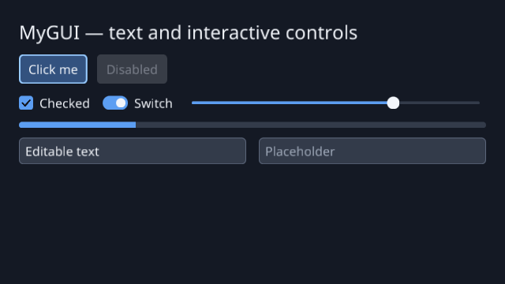

# MyGUI

A small C++20 GUI library and demo using GLFW, OpenGL 3.3, and FreeType.
It supports layouts, wrapped text, images, scrolling, themes, and controls
including buttons, checkboxes, switches, sliders, progress bars, and text fields
with selection and clipboard support.



The image above is a real render of the library's widget suite (labels,
buttons, checkboxes, switches, sliders, progress bars, and text fields),
captured from the renderer test suite; no mockups are used.

Linux CI runs Debug and Release builds and all tests under Xvfb/Mesa. Windows
and macOS CI build everything and run headless tests; their rendering and window
behavior are not yet tested.

## Build and run

### 1. Install dependencies

You need Git, a C++20 compiler, CMake 3.20 or newer, Ninja, and development files
for GLFW, OpenGL, and FreeType.

Ubuntu/Debian:

```sh
sudo apt-get update
sudo apt-get install git build-essential cmake ninja-build libglfw3-dev libgl1-mesa-dev libfreetype-dev
```

Fedora:

```sh
sudo dnf install git gcc-c++ cmake ninja-build glfw-devel mesa-libGL-devel freetype-devel
```

macOS (Homebrew):

```sh
brew install cmake ninja glfw freetype
```

### 2. Get the source

```sh
git clone https://github.com/golba98/MyGUI.git
cd MyGUI
```

If you already have the source, open a terminal in the repository folder.
Run the remaining commands from that folder.

### 3. Build and launch the demo

```sh
cmake --preset debug
cmake --build --preset debug
./build/debug/MyGUI
```

The demo opens a window with buttons, a click counter, and overlapping panels.
Font assets are bundled and copied beside the executable, so you can also launch
it from another working directory.

For a Release build:

```sh
cmake --preset release
cmake --build --preset release
./build/release/MyGUI
```

On Windows, use Visual Studio with [vcpkg](https://vcpkg.io):

```powershell
vcpkg install glfw3 freetype --triplet x64-windows
cmake -S . -B build -DCMAKE_TOOLCHAIN_FILE="$env:VCPKG_ROOT/scripts/buildsystems/vcpkg.cmake"
cmake --build build --config Debug
.\build\Debug\MyGUI.exe
```

## Try the demo

| Control | Action |
| --- | --- |
| Click a button | Toggle the overlay or increase the counter |
| Tab / Shift+Tab | Move keyboard focus forward / backward |
| Enter / Space | Activate the focused button |
| V | Toggle the overlay |
| Hover the overlay | Change its color |
| Resize the window | See the layout adjust |

The disabled button does not respond. Input diagnostics show mouse movement,
scrolling, and key/button state.

Optional command-line arguments:

| Option | Purpose |
| --- | --- |
| `--help` | Show available arguments |
| `--font PATH` | Use a different scalable Unicode font |
| `--width N --height N` | Set the starting window size |
| `--log-events` | Print input and window events to the terminal |
| `--frames N` | Exit after N frames for a smoke test |

For example:

```sh
./build/debug/MyGUI --width 960 --height 640 --log-events
```

## Run tests

After building Debug, run all tests:

```sh
ctest --preset debug
```

Renderer and window tests need a display. To run all tests without one on
Ubuntu/Debian, use Xvfb and software rendering:

```sh
sudo apt-get install xvfb xauth
LIBGL_ALWAYS_SOFTWARE=1 xvfb-run -a ctest --preset debug
```

To run only the input, widget, layout, font, and image tests without a display:

```sh
ctest --preset debug -L headless
```

For a Release build, use `ctest --preset release` instead.
See [test details](docs/usage.md#test-details) for CI coverage, disabling tests,
and renderer snapshots.

## Examples

Small programs in `examples/` show one topic each and build next to the demo (`-DMYGUI_BUILD_EXAMPLES=OFF` skips them):

- `MyGUI_hello` (`examples/hello.cpp`): a label and a button, the minimum setup.
- `MyGUI_layout` (`examples/layout.cpp`): nested layouts, flex weights and wrapped text that reflows on resize.
- `MyGUI_widgets` (`examples/widgets.cpp`): every built-in control inside a scroll view.

`examples/common/Example.hpp` holds their shared font lookup and event loop. Each accepts `--frames N` for smoke tests. The full demo lives in `examples/demo/main.cpp` and builds as `MyGUI`.

## Use the library

Read the [usage reference](docs/usage.md) for widget examples, event handling,
layout, rendering, and resource lifetimes. The [demo source](examples/demo/main.cpp) shows
how to put these together in an application.

The library owns its widget trees. Public headers hide native GLFW, OpenGL, and
FreeType types. Window operations, input handling, and drawing run on the main
thread; the reference explains the required event loop and resource ordering.

### CMake integration

Install the library and use the exported CMake package:

```sh
cmake --install build/release --prefix /path/to/prefix
```

```cmake
find_package(MyGUI 0.1 REQUIRED)
target_link_libraries(app PRIVATE MyGUI::MyGUI)
```

The package installs the public headers under `include/gui`, the static library, and the bundled Noto Sans font under `share/MyGUI/fonts`. Because MyGUI is static, its package finds GLFW and FreeType for you. `tests/package` is a minimal consumer that CI builds against a fresh install. When MyGUI is added with `add_subdirectory`, link `MyGUI::MyGUI`; its tests are not built, and examples and install rules default to off (`MYGUI_BUILD_EXAMPLES`, `MYGUI_INSTALL`).

## Current limits

Multi-line text editing, complex-script shaping,
bidirectional layout, color emoji, and native accessibility integration are not
included. Labels and buttons clip text that exceeds their bounds.

The bundled Noto Sans font uses the SIL Open Font License. See its
[source](assets/fonts/SOURCE.md) and [license](assets/fonts/OFL.txt).
